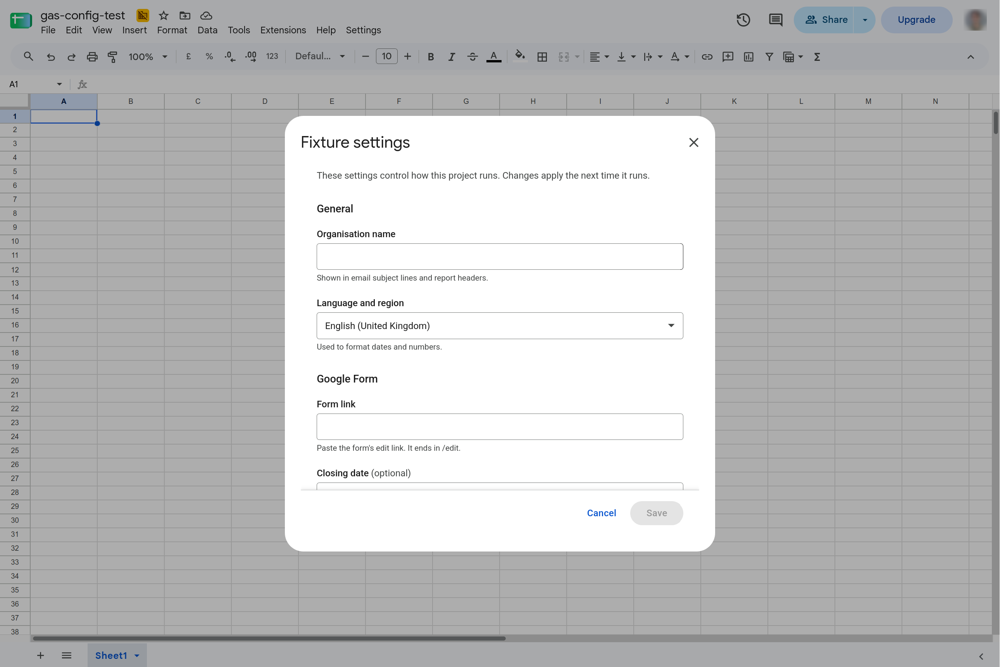
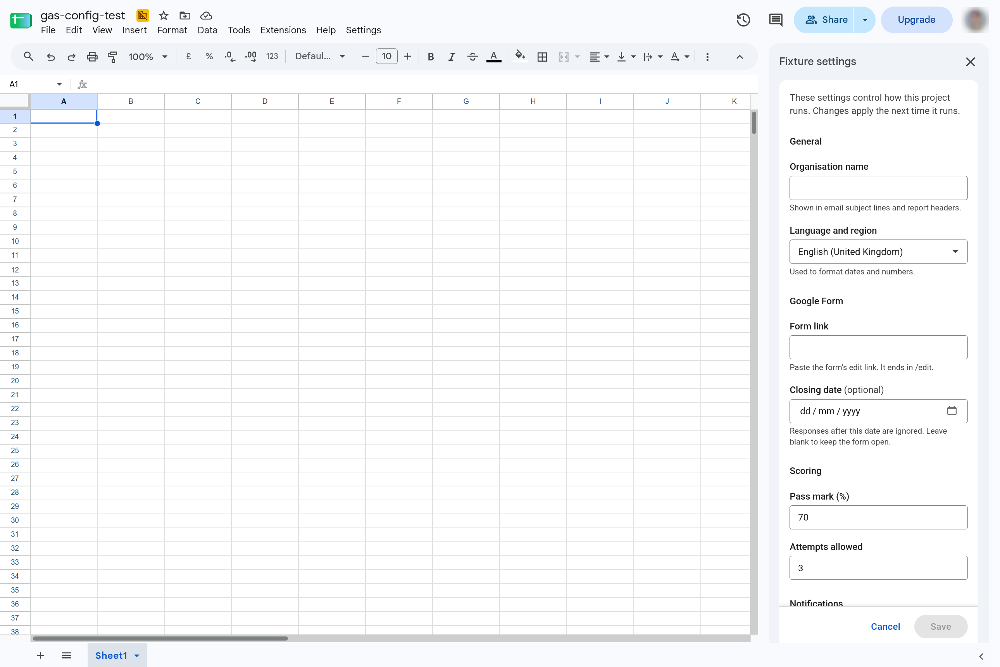
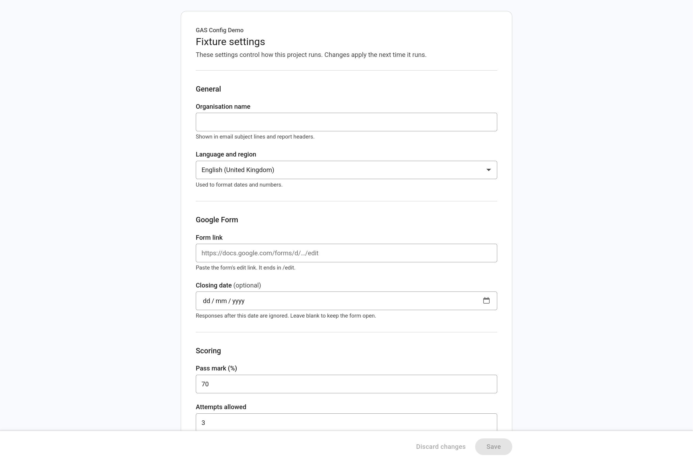
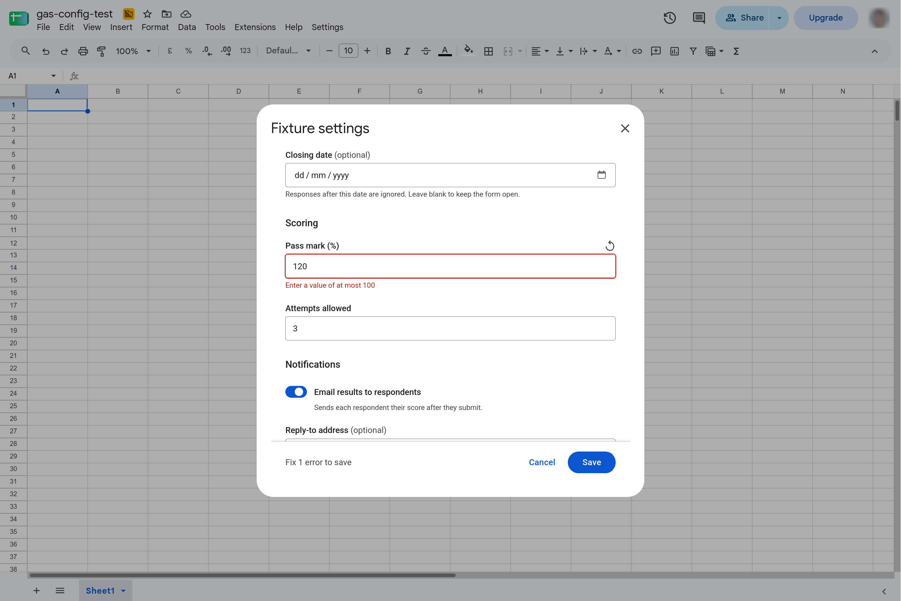
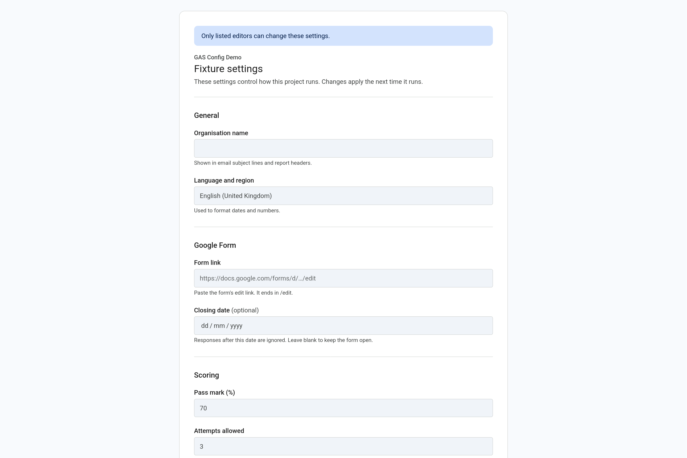
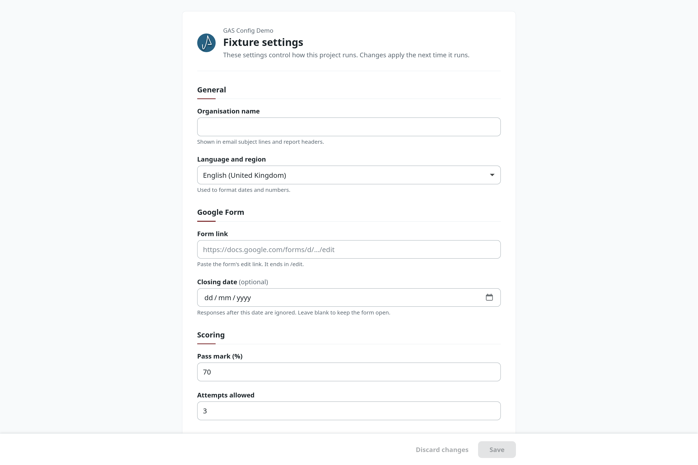

# gas-config

[](https://developers.google.com/apps-script)

## A settings UI for Google Apps Script projects.

> The goal of this project is to let a management team change the values an Apps Script project runs on, from a friendly interface inside Sheets, Docs, Slides, Forms or a web page, without opening the script editor.

`gas-config` stores typed configuration in Script Properties and gives it a settings UI built from a schema you declare in code. The UI opens as a dialog or a sidebar in the host document, or as a web page for standalone scripts. It looks native to Google Workspace by default, or carries your own brand. Your code reads the values with `config.get(...)`.



> **Disclaimer:**
> This project and [Yorsh](https://github.com/yorsh-co) are independent and are not affiliated with, endorsed by, or associated with Google LLC.

> **Upgrading from 1.x?**
> 2.0 replaces the sheet-backed library. There is no `.config` sheet, no presets and no migration path; see the [CHANGELOG](https://github.com/yorsh-co/gas-config/blob/main/CHANGELOG.md) for what changed.

### Features

- A schema in code: `string`, `text`, `url`, `select`, `date`, `number` and `boolean` fields, in groups, with labels, descriptions, defaults and validation rules
- Typed reads: `get('passMark')` is `number | null` and `get('enabled')` is `boolean`, inferred from the schema
- One settings UI for a modal dialog, the sidebar and a full web page, in Sheets, Docs, Slides and Forms, and in standalone web apps
- Two themes, `workspace` and `yorsh`, with a brand colour and logo override
- The same validation in the browser and on the server, plus server-only checks that return a message
- An `editors` allowlist. Everyone else sees the settings read-only
- Atomic saves under the script lock, with conflict detection and safe retries
- Change logging through GasLogger or `console`
- Written in TypeScript; ships compiled `.js` plus matching `.d.ts` files
- No dependencies beyond built-in Apps Script services and its optional peers (see [Peer Dependencies](#peer-dependencies))

### Example Usage

```js
const config = new GasConfig({
  title: 'Course settings',
  editors: ['admin@example.org'],
  schema: {
    passMark: {
      type: 'number',
      label: 'Pass mark',
      default: 70,
      integer: true,
      min: 0,
      max: 100,
    },
    notify: { type: 'boolean', label: 'Email results', default: true },
  },
});

function onOpen() {
  SpreadsheetApp.getUi()
    .createMenu('Settings')
    .addItem('Open settings', 'openSettings')
    .addToUi();
}

function openSettings() {
  config.showDialog(SpreadsheetApp.getUi());
}

function gradeAll() {
  if (config.get('notify')) {
    // ...
  }
  return config.get('passMark'); // number | null
}
```

## Requirements

### Peer Dependencies

`gas-config` uses the following as globals at runtime when they are loaded. All are optional: each is a separate gas-\* library, bundled alongside `gas-config` by gas-dev-bundle, and every use is guarded with a fallback.

| Package                                                | Adds                                                                                                                                                    | Without it                                                             |
| ------------------------------------------------------ | ------------------------------------------------------------------------------------------------------------------------------------------------------- | ---------------------------------------------------------------------- |
| [`gas-lock`](https://github.com/yorsh-co/gas-lock)     | Reentrancy-safe locking: a save never ends an outer critical section of the same execution early                                                        | `LockService` is used directly, with no tracking of locks already held |
| [`gas-error`](https://github.com/yorsh-co/gas-error)   | `GasValidationError`, `GasUnauthorizedError` and `GasError`, thrown for expected failures, and `GasError.handle` building the [error envelope](#errors) | A `GasConfigError` with the same `statusCode` and `code` is thrown     |
| [`gas-logger`](https://github.com/yorsh-co/gas-logger) | Structured logging through the `logger` option, with the sinks, levels and bindings of the logger you pass                                              | Messages go to the execution log through `console`                     |

### Scopes

| Scope                                                 | Requested because                                                                         |
| ----------------------------------------------------- | ----------------------------------------------------------------------------------------- |
| `https://www.googleapis.com/auth/userinfo.email`      | The signed-in user is checked against `editors` with `Session.getActiveUser().getEmail()` |
| `https://www.googleapis.com/auth/script.container.ui` | Your code opens the dialog or sidebar through the host's `getUi()`                        |

Apps Script detects both from the code, so you do not list them in `appsscript.json`. `gas-config` never names a container service (`SpreadsheetApp`, `DocumentApp`, `SlidesApp` or `FormApp`): Apps Script derives scopes by scanning the code for service names, and one reference would ask a Docs project for access to Sheets. Instead you pass your own `getUi()` to [`showDialog`](#show-the-settings-in-a-dialog) and [`showSidebar`](#show-the-settings-in-a-sidebar), so the project is asked for the scopes of the services it uses and no more. Your own `getUi()` call names the host service, which adds that host's scope; `/** @OnlyCurrentDoc */` narrows it to the `…currentonly` scope. A project that only serves the settings as a web page never calls `getUi()` and is not asked for `script.container.ui`.

### Deployment

In a container-bound script (Sheets, Docs, Slides or Forms) there is nothing to deploy: the dialog and sidebar run as the user who opens them.

To serve the settings as a web page from a standalone script, deploy a **Web App** (Apps Script editor → Deploy → New deployment → Web app) whose `doGet` returns `config.createHtmlOutput()`. Deploy it with **Execute as: User accessing the web app**, with the `userinfo.email` scope granted. Restrict **Who has access** to the people who should see the settings: users who are not editors still see the values, read-only.

Under **Execute as: Me**, consumer accounts and callers outside your domain have a blank email. They cannot be identified, so the page is read-only for them and a save is refused with a 401.

### Example `appsscript.json`

```json
{
  "timeZone": "America/Sao_Paulo",
  "dependencies": {},
  "exceptionLogging": "STACKDRIVER",
  "runtimeVersion": "V8",
  "webapp": {
    "executeAs": "USER_ACCESSING",
    "access": "DOMAIN"
  }
}
```

The `webapp` block is only needed for the web page. No `oauthScopes` are listed on purpose: Apps Script adds the detected ones.

## Quick Start

It is recommended to use `gas-config` together with [Google's `clasp` CLI](https://github.com/google/clasp) for local Apps Script development and git-based workflows. See [Setup instructions with `clasp`](#setup-instructions-with-clasp) for more information.

#### 1. Add the library to your Apps Script project

##### Several gas-\* libraries: gas-dev-bundle

[gas-dev-bundle](https://github.com/yorsh-co/gas-dev-bundle) resolves version ranges against the libraries' release tags and writes them into one script, in dependency order.

```bash
npm install -D github:yorsh-co/gas-dev-bundle#semver:^2.0.0
```

List the libraries in your `package.json`:

```json
{
  "gasDevBundle": {
    "outFile": "src/lib/gas-libraries.js",
    "libraries": {
      "gas-config": "^2.0.0",
      "gas-lock": "^1.2.0",
      "gas-error": "^1.2.2",
      "gas-logger": "^2.0.1"
    }
  }
}
```

```bash
npx gas-dev-bundle
```

- Commit the generated file. Its header records each library's version and commit SHA.
- Re-run the command after changing a range to upgrade.
- Listing `gas-lock`, `gas-error` or `gas-logger` bundles it ahead of `gas-config`, which uses them when present. gas-dev-bundle treats peers as optional and never adds one on its own, so list the ones you want (P6).

See the [gas-dev-bundle README](https://github.com/yorsh-co/gas-dev-bundle) for configuration details.

##### This library only: git subtree

The library also ships on its own `dist` branch. Without gas-dev-bundle, add it and each peer you use with git subtree:

```bash
git subtree add \
  --prefix=src/lib/gas-config \
  https://github.com/yorsh-co/gas-config.git \
  dist \
  --squash
```

This creates:

```txt
src/lib/gas-config/
```

You then own the [file push order](#5-configure-the-file-push-order) of the peers and `gas-config`.

#### 2. Make the library load first

Apps Script executes files in the order of the project, and `new GasConfig(...)` runs when your file does. Put the library ahead of your own files. See [Configure the file push order](#5-configure-the-file-push-order).

#### 3. Declare a `GasConfig` instance and open it

```js
const config = new GasConfig({
  editors: ['admin@example.org'],
  schema: {
    passMark: { type: 'number', label: 'Pass mark', default: 70 },
  },
});

function openSettings() {
  config.showDialog(SpreadsheetApp.getUi());
}
```

See [Basic Usage](#basic-usage).

## Setup instructions with `clasp`

#### 1. Install clasp

```bash
npm install -g @google/clasp
```

#### 2. Enable the [Apps Script API](https://script.google.com/home/usersettings)

#### 3. Login to Google Apps Script

```bash
clasp login
```

#### 4. Clone or create your Apps Script project

Clone an existing project:

```bash
clasp clone <script-id>
```

or create a new project bound to a document:

```bash
clasp create --type sheets
```

Use `--type docs`, `--type slides` or `--type forms` for the other hosts, or `--type webapp` for a standalone script.

<a id="5-configure-the-file-push-order"></a>

#### 5. Configure the file push order

Apps Script executes files by the order in the Apps Script editor, from top to bottom. By default, `clasp push` orders files alphabetically by file name.

A `const config = new GasConfig(...)` at the top level of your file runs when that file does. If it runs before the library's files, `clasp push` succeeds but running the project throws:

```txt
ReferenceError: GasConfig is not defined
```

With gas-dev-bundle the library and its peers are one file, so a single [`filePushOrder`](https://github.com/google/clasp#filepushorder-optional) entry in `.clasp.json` is enough:

```json
{
  "filePushOrder": ["src/lib/gas-libraries.js"]
}
```

Alternatively, you can manually move the file to the top of the file list in the Apps Script editor.

With the git subtree method, list the files yourself, peers first. For `gas-config` the order is:

```json
{
  "filePushOrder": [
    "src/lib/gas-config/shared/gas-config.validation.js",
    "src/lib/gas-config/generated/gas-config.ui.html.js",
    "src/lib/gas-config/gas-config.errors.js",
    "src/lib/gas-config/gas-config.storage.js",
    "src/lib/gas-config/gas-config.access.js",
    "src/lib/gas-config/gas-config.class.js",
    "src/lib/gas-config/gas-config.ui.js"
  ]
}
```

> **Note:**
> Use the path where the files land in your pushed project, e.g. `src/lib/gas-config/...` when pushing the subtree as-is. If `.clasp.json` sets a `rootDir` or you push a build output folder, use the paths relative to that folder instead. Files ending in `.types.js` and the `.d.ts` files are not needed at runtime.
>
> `GasConfig` itself does not need the peers at load time: it looks them up when it locks, throws or logs. Any file in your own project that constructs a `GasConfig` at the top level must be pushed _after_ the entries above.

#### 6. Push local files to Apps Script

```bash
clasp push
```

## Basic Usage

### Create a `GasConfig` instance

Declare the instance once, at global scope:

```js
const config = new GasConfig({
  title: 'Course settings',
  description: 'Values the grading scripts read at run time.',
  editors: ['admin@example.org', 'teacher@example.org'],
  groups: [
    { id: 'general', label: 'General' },
    {
      id: 'grading',
      label: 'Grading',
      description: 'Thresholds used when scoring.',
    },
  ],
  schema: {
    orgName: {
      type: 'string',
      label: 'Organisation',
      group: 'general',
      required: true,
      default: '',
    },
    reportUrl: { type: 'url', label: 'Report link', group: 'general' },
    passMark: {
      type: 'number',
      label: 'Pass mark',
      group: 'grading',
      default: 70,
      integer: true,
      min: 0,
      max: 100,
    },
    deadline: { type: 'date', label: 'Deadline', group: 'grading' },
    mode: {
      type: 'select',
      label: 'Mode',
      group: 'grading',
      default: 'strict',
      options: [
        { value: 'strict', label: 'Strict' },
        { value: 'lenient', label: 'Lenient' },
      ],
    },
    notify: {
      type: 'boolean',
      label: 'Email results',
      group: 'grading',
      default: true,
    },
  },
});
```

The instance must live at global scope because the settings UI calls back into your project through `GasConfigRpc`, a separate execution that starts from a blank global scope. `GasConfigRpc` routes to the most recently constructed `GasConfig`, so a project has one settings UI. The constructor validates the schema and options and throws a `[GasConfig]` error for a mistake, but touches no Apps Script service, so a global `new GasConfig(...)` costs nothing until first use.

| Option          | Type                          | Description                                                                                          |
| --------------- | ----------------------------- | ---------------------------------------------------------------------------------------------------- |
| `schema`        | `GasConfigSchema`             | Required. The fields, keyed by config key. See [Schema reference](#schema-reference)                 |
| `groups`        | `GasConfigGroup[]`            | Sections of the UI, as `{ id, label, description? }`. A field joins one with `group`. Ids are unique |
| `editors`       | `string[]`                    | Emails allowed to change the settings. Omitted or empty means nobody. See [Access](#access)          |
| `title`         | `string`                      | Heading of the UI and default title of the dialog, sidebar and page. Default `'Settings'`            |
| `description`   | `string`                      | Text under the heading                                                                               |
| `appName`       | `string`                      | Project name shown above the title on the page, and in the browser tab as `<title> · <appName>`      |
| `theme`         | `'workspace' \| 'yorsh'`      | Default `'workspace'`. See [Theming](#theming)                                                       |
| `brand`         | `{ primaryColor?, logoUrl? }` | Brand overrides. See [Theming](#theming)                                                             |
| `logger`        | `{ info, warn }`              | A GasLogger instance or `console`. Default: the execution log, prefixed `[GasConfig]`                |
| `lockService`   | `{ withLock }`                | Default: `GasLock` when loaded, else `LockService` directly                                          |
| `lockTimeoutMs` | `number`                      | How long a save waits for the script lock. Default `30000`                                           |

A config key starts with a letter, followed by letters, digits, `_`, `.` or `-`.

### Add the menu handlers

In a container-bound script, add a menu in `onOpen` and open the settings from its handler. The host `Ui` comes from your own code:

```js
function onOpen() {
  SpreadsheetApp.getUi() // DocumentApp, SlidesApp or FormApp elsewhere
    .createMenu('Settings')
    .addItem('Open dialog', 'openSettings')
    .addItem('Open sidebar', 'openSettingsSidebar')
    .addToUi();
}
```

Menu handlers are looked up by name and must be top-level function declarations whose names do not end in `_`. A trailing underscore makes a function private in Apps Script, so `openSettings_` cannot be called from a menu and the item does nothing.

<a id="show-the-settings-in-a-dialog"></a>

### Show the settings in a dialog

```js
function openSettings() {
  config.showDialog(SpreadsheetApp.getUi());
}
```

`showDialog(ui, options?)` opens a modal dialog. `ui` is the host's `Ui`, and a missing one throws a `[GasConfig]` error.

| Option   | Type     | Description                                        |
| -------- | -------- | -------------------------------------------------- |
| `title`  | `string` | Dialog title. Default: the `title` of the instance |
| `width`  | `number` | Pixels, a positive integer. Default `600`          |
| `height` | `number` | Pixels, a positive integer. Default `560`          |

```js
config.showDialog(SpreadsheetApp.getUi(), {
  title: 'Course settings',
  width: 720,
  height: 640,
});
```

<a id="show-the-settings-in-a-sidebar"></a>

### Show the settings in a sidebar

```js
function openSettingsSidebar() {
  config.showSidebar(SpreadsheetApp.getUi());
}
```

`showSidebar(ui, options?)` takes the same `ui` and an optional `title`. The width of a sidebar is fixed by the host (P8).



### Serve the settings as a web page

```js
function doGet() {
  return config.createHtmlOutput();
}
```

`createHtmlOutput(options?)` returns an `HtmlOutput` for a web app's `doGet`, with an optional `title`. It needs the [deployment](#deployment) described above. To keep the settings behind your own router, see [Using with gas-webapp](#using-with-gas-webapp).



### Read values

```js
const passMark = config.get('passMark'); // number | null
const notify = config.get('notify'); // boolean
const all = config.getAll(); // { orgName: string | null, passMark: number | null, ... }
```

- `get(key)` returns the stored value, else the field's `default`, else `null`. Booleans are never `null` (the default is `false`).
- An unknown key throws `[GasConfig] Unknown config key: <key>`, and a TypeScript project sees it as a type error.
- `getAll()` returns a fresh object on each call.
- Properties are read once per instance and then served from memory, so a value saved in another execution shows up in the next execution.
- Reads are never gated by `editors`.

There is no setter: values are written by the settings UI, through a save that validates every change.

## Schema reference

### Field types

| `type`    | Value type | Empty  | Rules                                    | Notes                                                                              |
| --------- | ---------- | ------ | ---------------------------------------- | ---------------------------------------------------------------------------------- |
| `string`  | `string`   | `null` | `maxLength`, `pattern`, `patternMessage` | Single line                                                                        |
| `text`    | `string`   | `null` | `maxLength`, `pattern`, `patternMessage` | Multiple lines                                                                     |
| `url`     | `string`   | `null` | `maxLength`, `pattern`, `patternMessage` | Must start with `https://`                                                         |
| `select`  | `string`   | `null` | `options`                                | `options` is a non-empty array of `{ value, label }` with unique, non-empty values |
| `date`    | `string`   | `null` | none                                     | `'YYYY-MM-DD'`, a real calendar date                                               |
| `number`  | `number`   | `null` | `min`, `max`, `integer`                  | Finite numbers only. `min` must not exceed `max`                                   |
| `boolean` | `boolean`  | never  | none                                     | Defaults to `false`. `required` has no effect                                      |

### Common keys

| Key           | Type                        | Description                                                                                                      |
| ------------- | --------------------------- | ---------------------------------------------------------------------------------------------------------------- |
| `type`        | field type                  | Required. Constrains `default` and the rules                                                                     |
| `label`       | `string`                    | Required, non-empty                                                                                              |
| `description` | `string`                    | Help text under the control                                                                                      |
| `group`       | `string`                    | The `id` of an entry of `groups`                                                                                 |
| `required`    | `boolean`                   | An empty required field is invalid until filled. Default `false`                                                 |
| `default`     | by type                     | Returned while nothing is stored. A non-empty default must pass the field's own rules, or the constructor throws |
| `placeholder` | `string`                    | Placeholder of the control                                                                                       |
| `validate`    | `(value) => string \| null` | Server-only check; see [Server-only validation](#server-only-validation)                                         |

A required field may have an empty default, or none: it reads as `null` and shows as invalid until someone fills it in. Optional fields may be empty for every type.

### Validation messages

Rules are checked in the browser while the user edits, and again on the server for every save. Empty optional values are always valid. These are the exact messages:



| Rule                    | Message                                    |
| ----------------------- | ------------------------------------------ |
| `required` and empty    | `This field is required`                   |
| Not a finite number     | `Enter a number`                           |
| `integer`               | `Enter a whole number`                     |
| `min`                   | `Enter a value of at least {min}`          |
| `max`                   | `Enter a value of at most {max}`           |
| `maxLength`             | `Use {maxLength} characters or fewer`      |
| `pattern`               | `patternMessage`, or `Enter a valid value` |
| `url` type              | `Enter a link starting with https://`      |
| `select` type           | `Choose one of the options`                |
| `date` type             | `Enter a valid date`                       |
| Value of the wrong type | `Enter a valid value`                      |

`pattern` is a regular expression source without delimiters or flags, for example `'^[A-Z]{3}-\\d{4}$'`. An invalid expression is a constructor error.

### Server-only validation

`validate(value)` runs on the server, for non-empty values that already pass the rules above. It returns an error message, or `null` when the value is valid. The message is shown next to the field.

```js
const config = new GasConfig({
  schema: {
    contact: {
      type: 'string',
      label: 'Contact',
      validate: (value) =>
        value.endsWith('@example.org') ? null : 'Use a company address',
    },
  },
});
```

A `validate` that throws is treated as an unexpected failure: the user sees a generic error and the real one is logged (see [Errors](#errors)). Return a message instead.

### Values

Values cross `google.script.run` as JSON, so dates are `'YYYY-MM-DD'` strings, not `Date` objects, and empty values are `null` (P1). `get()` on a `date` field returns the string; convert it where you need a `Date`.

## Access

`editors` is an allowlist of the emails that may change the settings.

- Emails are trimmed, lowercased, deduplicated and checked to be email-shaped; anything else throws in the constructor. They are compared case-insensitively with `Session.getActiveUser().getEmail()`.
- Omitted or empty means nobody can edit: the settings are read-only for everyone.
- A user who is not listed, or who cannot be identified, gets a read-only view of the values with the banner `Only listed editors can change these settings.` and no Save button.
- A save from such a user fails with a 401 before the lock is taken or anything is read: `[GasConfig] Unable to identify the signed-in user` when `Session` throws or returns an empty email, and `[GasConfig] Not authorized` when the user is not listed. Neither message contains the email. The UI switches to read-only.
- The user is read lazily, once per instance. `get()` and `getAll()` are never gated.



> **Warning:**
> `editors` is a guard for people using the settings UI, not a security boundary. Anyone who can edit the script, or the container of a bound script, can read and change Script Properties directly or run code that does.

## Storage

Values live in Script Properties.

- **Keys.** One property per config key, named `gasConfig:<key>` and JSON-encoded, so numbers and booleans keep their type. Two more hold the version stamp (`gasConfig:__version`) and the id of the last save (`gasConfig:__saveId`). Keys must start with a letter, so none can reach them.
- **One write per save.** A save takes the script lock (GasLock when loaded, otherwise `LockService`), re-reads the properties, validates every change, and writes only the changed keys, the new version and the `saveId` in one `setProperties` call. If the write throws, nothing changed. A cleared field is stored as JSON `null`, which reads as unset. A save that changes nothing writes nothing.
- **Conflicts.** The UI sends the version it loaded with each save. If the stored version has moved on, nothing is written and the UI offers to reload the latest values.
- **Safe retries.** `google.script.run` sometimes drops a call without a word. Each save carries a client-generated `saveId`, and a retry reuses it. If the server already applied that `saveId`, it replays the success instead of reporting a false conflict. A save that times out is retried once, then the user can try again.
- **Invalid stored values.** If a stored value fails validation (edited by hand, or left over from a changed schema), `get()` returns the field default and logs a warning that names the key and never the value. The other keys are unaffected. The UI shows the stored value flagged as an error, so someone can fix it.
- **Limits.** Script Properties hold up to 9 KB per value and 500 KB in total, and have daily read and write quotas (P7). Configuration rarely comes near them.
- **Not for secrets.** Anyone with script access can read the properties, and the UI shows every value to anyone who can open it. Do not store API keys or passwords here. Write-only secret fields are planned for 2.1 (see [Planned features](#planned-features)).

## Theming

| Option               | Description                                                                                  |
| -------------------- | -------------------------------------------------------------------------------------------- |
| `theme: 'workspace'` | The default. Material 3 as used in Google Workspace, so the UI feels native to the host      |
| `theme: 'yorsh'`     | The Yorsh brand look                                                                         |
| `brand.primaryColor` | `#rgb` or `#rrggbb`. Replaces the theme's primary colour on buttons, focus rings and accents |
| `brand.logoUrl`      | An `https:` URL or a `data:image/` URI. Shown on every surface in the `yorsh` theme only     |

```js
const config = new GasConfig({
  theme: 'yorsh',
  brand: {
    primaryColor: '#276182',
    logoUrl: 'https://example.org/logo.svg',
  },
  schema: {/* ... */},
});
```



The options are validated in the constructor. Brand overrides set design tokens only; the layout is the same for every brand. The page loads the Roboto font from Google Fonts and falls back to the system font (P9).

## Change logging

Every successful save that changes a value logs one `info` entry, `[GasConfig] Settings changed`, with the user and each changed key's old and new value:

```js
const config = new GasConfig({
  logger: gasLogger, // a GasLogger instance, or console
  schema: {/* ... */},
});
```

The entry is written after the lock is released, so a slow logger cannot extend it. A logger that throws is reported through `console` and never fails a save. Warnings, such as a stored value that was replaced by its default, go through `logger.warn`. Without a `logger`, entries go to the execution log with the `[GasConfig]` prefix.

Remember that the entry contains the values. Keep that in mind when you choose a log sink, and do not store secrets as settings.

## Errors

The settings UI and the server talk through one entry point, `GasConfigRpc(method, payload)`. A failed call throws an `Error` whose message is a JSON envelope, the same one gas-webapp uses:

```ts
{ ok: false, status: number, code: string, error: string, details?: unknown }
```

| `code`             | `status` | When                                                                                                        |
| ------------------ | -------- | ----------------------------------------------------------------------------------------------------------- |
| `VALIDATION_ERROR` | 400      | A malformed save request, an unknown key, or an unknown method                                              |
| `UNAUTHORIZED`     | 401      | The user cannot be identified, or is not an editor                                                          |
| `INTERNAL_ERROR`   | 500      | Anything unexpected: the user sees `Something went wrong. Try again.`, the real error goes to `logger.warn` |

- Expected failures keep their status, code and message. Anything else becomes a generic 500, so internals never reach the browser.
- A value that fails validation is not an error: `saveSettings` returns `{ ok: false, reason: 'invalid', errors }` with a message per key, and `{ ok: false, reason: 'conflict', version }` for a conflict. A conflict is only ever that save result, never a thrown error.
- With gas-error loaded, expected failures are its `GasValidationError`, `GasUnauthorizedError` and `GasError` classes, and `GasError.handle(err, { rethrow: false })` builds the envelope, so a project using both libraries handles errors one way. Without it they are `GasConfigError`, which carries the same `statusCode`, `code` and `details`.
- Every message carries the `[GasConfig]` prefix. Mistakes in your configuration, such as a bad schema, a bad option or a missing `ui`, are plain `Error`s thrown when the code runs; they are not expected failures and have no code.

## Using with gas-webapp

A standalone script that already serves a [gas-webapp](https://github.com/yorsh-co/gas-webapp) app owns `doGet`. gas-webapp's `res` cannot send a prebuilt `HtmlOutput`, so the settings page is not a route. Return it from your `doGet` for the settings path, before delegating to the app:

```ts
const config = new GasConfig({
  editors: ['admin@example.org'],
  schema: {/* ... */},
});
const app = new GasWebApp();

function doGet(e: GoogleAppsScript.Events.DoGet) {
  if (e.parameter.route === '/settings') {
    return config.createHtmlOutput();
  }
  return app.doGet(e);
}

function doPost(e: GoogleAppsScript.Events.DoPost) {
  return app.doPost(e);
}
```

- This bypasses the app's middleware, which is fine: `gas-config` authorizes every call itself.
- Use the `route` parameter. An anonymous GET with a path after `/exec` never reaches the script (gas-webapp P4).
- The page's browser code calls `GasConfigRpc` directly through `google.script.run`, not through the router, so it needs no route and no `GasWebApp` browser client.
- Both libraries want **Execute as: User accessing the web app** and the `userinfo.email` scope.

## Platform limitations

These are Apps Script constraints. They are documented, not fixed.

| ID  | Limitation                                                                                                                                                                                                                                              |
| --- | ------------------------------------------------------------------------------------------------------------------------------------------------------------------------------------------------------------------------------------------------------- |
| P1  | `google.script.run` carries JSON only: `Date` objects and `undefined` do not survive. The contract uses `'YYYY-MM-DD'` strings and `null`.                                                                                                              |
| P2  | `google.script.run` reaches top-level function declarations only, and not names ending in `_`. `GasConfigRpc` is a function declaration for that reason; an alias such as `const GasConfigRpc = ...` is not reachable. The same goes for menu handlers. |
| P3  | The dialog and sidebar need a container UI, which `clasp run` does not have. `npm run test:gas` cannot exercise them; the [`manual/`](https://github.com/yorsh-co/gas-config/tree/main/manual) fixture does.                                            |
| P4  | `HtmlService` drops a viewport `<meta>` written in the page. `createHtmlOutput` adds it with `addMetaTag`; any page you build around it must do the same to be usable on a phone.                                                                       |
| P5  | The push-time parser rejects ES2021 syntax and `async`/`await`, so the library is compiled to ES2020 and has no async functions. The `gas` ESLint preset of `gas-dev-config` forbids them in Apps Script sources.                                       |
| P6  | Peers are optional by definition, and gas-dev-bundle never adds one on its own. A project bundled without a peer does not fail; it behaves as described in [Peer Dependencies](#peer-dependencies), which shows only at runtime.                        |
| P7  | Script Properties allow 9 KB per value, 500 KB in total, and daily read and write quotas.                                                                                                                                                               |
| P8  | The host controls the size of a sidebar (a fixed width) and may cap a dialog to the window; `width` and `height` are requests.                                                                                                                          |
| P9  | The page loads Roboto from Google Fonts. Where that is blocked, it falls back to the system font.                                                                                                                                                       |
| P10 | `Session.getActiveUser().getEmail()` is blank for consumer accounts and callers outside your domain when a web app executes as you, so those users cannot be identified and are read-only.                                                              |

### Platform notes

Observed on deployed projects (`manual/` fixture):

- **Consent wording.** The consent screen describes `script.container.ui` as "display and run third-party web content in prompts and sidebars".
- **Peers add scopes.** Apps Script scans every file pushed, peers included. With gas-logger 1.x bundled, a Docs, Slides or Forms project was also asked for `spreadsheets.currentonly`, because its sheet sink names `SpreadsheetApp`. gas-logger 2.x takes the spreadsheet from the caller, and the project asks for its own host's scope only.
- **No active container in a web app.** In `doGet`, the active-container getters (`SpreadsheetApp.getActive()` and the others) return `null`, even in a container-bound project. A name read from the container is therefore unavailable on the page surface, so pass `appName` explicitly.
- **Same behaviour on every host.** Checks 1 to 8 behaved identically in Sheets, Docs, Slides and Forms, each with its own `…currentonly` scope.

## Development

The source is TypeScript, compiled to ES2020 because Apps Script's push-time parser rejects newer syntax.

```bash
npm run check          # format, lint, typecheck (including typecheck:peer), unit tests, gas-dev-config check
npm run dev            # the UI in a browser against a mock server
npm run test:e2e       # Playwright flows against the harness
npm run test:gas       # Apps Script tests on a dedicated project (GAS_TEST_SCRIPT_ID)
npm run manual:build   # the fixture for the manual checks in Sheets, Docs, Slides, Forms and a web app
```

- Unit tests (Vitest) run against fakes of `PropertiesService`, `LockService`, `Utilities`, `Session` and `HtmlService`, and the released peers.
- `npm run dev` serves a harness that hosts the real UI in an imitation of each Workspace surface, with mock scenarios for slow calls, conflicts, read-only users, timeouts and invalid stored values. See [`dev/README.md`](https://github.com/yorsh-co/gas-config/tree/main/dev).
- `npm run test:e2e` drives the harness with Playwright. It is not part of `npm run check`.
- `npm run test:gas` pushes the library to a dedicated test project with clasp and runs checks against the real Script Properties, `LockService`, `Session` and `HtmlService`. Its contents are replaced on every run, and its ID stays out of the repository (`GAS_TEST_SCRIPT_ID`).
- `npm run manual:build` assembles a fixture project for the checks that need a real host. Set `MANUAL_CONFIG_SCRIPT_ID` and follow [`manual/README.md`](https://github.com/yorsh-co/gas-config/tree/main/manual).

### Editing the UI

The UI is written as `src/web/gas-config.ui.html`, `.css` and TypeScript. The library ships it as one string constant, generated into `src/generated/gas-config.ui.html.ts` by `gas-dev-config html`. After changing anything in `src/web/`, run:

```bash
npm run build:frontend
```

The generated file is committed and never edited by hand. `gas-dev-config check`, part of `npm run check`, fails when it is stale.

## Peer Type Declarations

Consuming gas-\* libraries can type-check against `GasConfig` without vendoring its source. The canonical declarations live in `peer/gas-config.peer.types.d.ts` at every `vX.Y.Z` tag. A consuming package lists `"gas-config": "<range>"` under `gasDevConfig.peers` in its `package.json` and runs `gas-dev-config peers sync` (gas-dev-config 1.10.0 or later). It writes `src/internal/gas-config.peer.types.d.ts` from the highest tag that satisfies the range, and `gas-dev-config peers sync --check` reports a stale copy. Do not edit the copy.

The file is type-checked standalone by `npm run typecheck:peer`, and a test compares it with `src/`, so a change to the public surface that is not mirrored there fails `npm run check`.

## Planned features

- Secrets as write-only fields, with a separate `secretEditors` allowlist (2.1)
- A settings-managed editors list, with an `admins` role
- Sending an `HtmlOutput` from a gas-webapp route, so the settings page can sit behind the app's middleware

## License

MIT

See the `LICENSE.md` file for details.

## Support

Issues and feature requests are welcome via GitHub Issues.

Maintained by [yorsh-co](https://github.com/yorsh-co).

---

> [!TIP]
> Found `gas-config` useful?
> Find more Google Apps Script libraries at [github.com/yorsh-co](https://github.com/yorsh-co).
